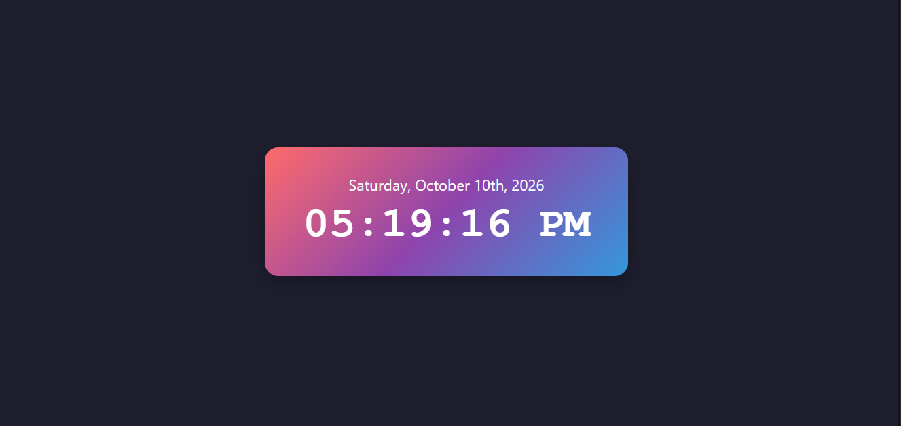

# Color Clock

A colorful digital clock built with React, Vite, and date-fns. It shows the current date and time and updates every second.

## Run locally
1. `git clone <your-repo-url>`
2. `cd color-clock`
3. `npm install`
4. `npm run dev`
5. Open http://localhost:5173

## Project structure
- `src/main.jsx`: entry point that mounts the app
- `src/App.jsx`: clock component (state, timer, date-fns formatting)
- `src/App.css`: clock styling
- `src/index.css`: global page styles

## Dependencies
- react, react-dom
- date-fns@2.30.0

## Screenshot

